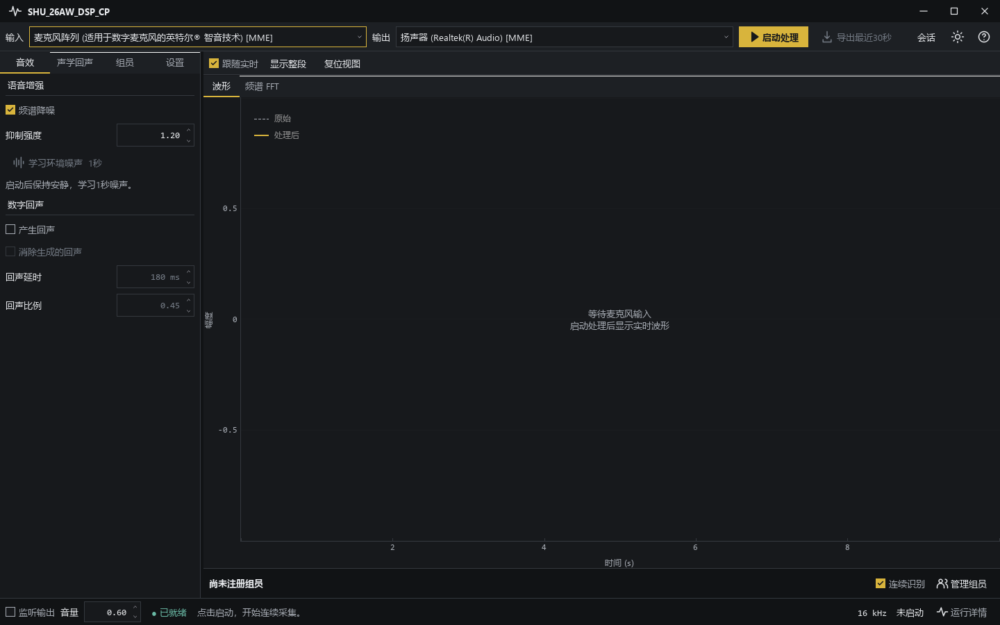

# SHU_26AW_DSP_CP

上海大学 2026 秋季《数字信号处理B》课程项目。

- 实时语音采集、增强与播放
- 回声产生、数字回声消除、NLMS 声学回声消除
- CAM++ 组员说话人识别
- 长时波形、频谱分析、四路会话录音与历史试听
- 深浅主题、图表设置

## 运行

Windows，Python 3.11。

```powershell
powershell -ExecutionPolicy Bypass -File .\setup.ps1
.\launch.cmd
```

## 测试

```powershell
.\.venv\Scripts\python.exe -m pytest -q
```



[方案](docs/01_方案调研与路线选择.md) · [会话参数](docs/09_长时波形与会话录音.md) · [验证记录](validation/long-session/summary.json) · [第三方来源](THIRD_PARTY.md)
