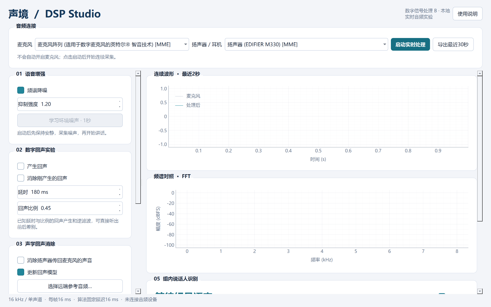
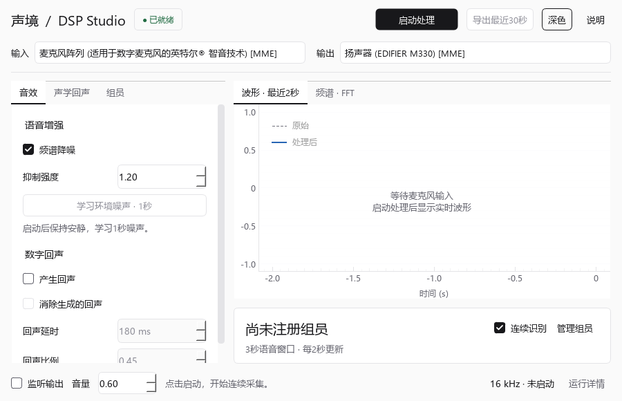
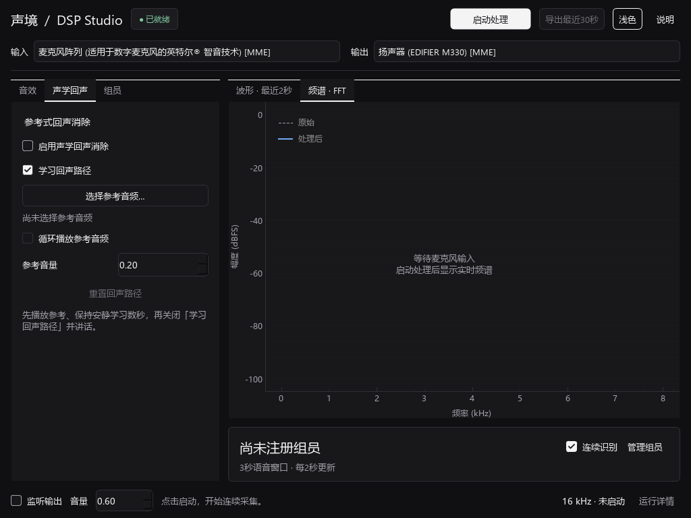

# 简要前端与验证

日期：2026-10-28。基于用户指定的 `C:/Users/xande/.codex/skills/workbench-ui-pipeline/SKILL.md`，沿用Qt Widgets与现有实时音频结构，当时采用青绿色。当前正式名称统一为 DSP Studio，最新界面见记录06。

## 界面调整

- 原来的纵向长面板改为两栏工作区；左侧“音效／声学回声／组员”页签，右侧“波形／频谱”页签。当前说话人在右下方持续可见。
- 顶部只保留启动/停止、导出、外观与说明，设备选择独占一行；长设备名保留完整提示。
- 监听与音量位于底部；延迟、欠载、超时、削波等完整读数进入“运行详情”，Esc只关闭详情窗口。
- 启动/停止与导出使用共享QAction绑定按钮和快捷键。未准备好、未采集、正在注册等状态有明确启用条件。
- 深浅主题从同一组语义token生成。Qt调色板、QSS、图表、输入框、页签、表格、提示与对话框统一接入。
- 切换页签或主题不重建音频任务，保留参数草稿；声纹分数刷新按姓名保留选中项；跨音频会话的旧识别结果不写回新会话。
- 关闭主窗口仍沿原路径停止独立音频进程，并等待自身后台任务结束。

界面契约：`ui/project-contract.json`。生成物：`ui/generated-v1/`。其中HTML与C++样板仅为技能生成时保留的参考，实际程序通过 `dsp_lab/theme.py` 使用生成QSS和token；没有另建Web服务。

## 验证记录

环境：Windows，Python 3.11.9、PySide6 Essentials 6.12.0，Qt Fusion。

1. 管线配置、生成一致性与20组文字对比度检查通过；技能包7项自测通过。
2. 目标程序的8项DSP回归测试通过，依赖一致性与Python语法检查通过。
3. `tools/verify_frontend.py` 使用受控音频状态，未打开麦克风、未注册真实声纹。每种缩放执行41项断言，包括共享动作、空状态、参数绑定、页签/主题状态保留、组员选中身份、详情窗口Esc、停止与导出状态。
4. 离屏矩阵为900×580、1024×768、1440×900三个逻辑尺寸，深/浅主题，Qt缩放因子1/1.5/2。每种缩放保留9张截图，包括附加交互状态；原始断言和环境记录见 `validation/ui/qa-scale-*.json`。Windows离屏平台不自动发现系统字体，验证脚本显式加载本机微软雅黑和Segoe字体，不改变系统字体设置。
5. 改后25秒真实音频联测通过：独立音频进程、Qt绘图与13次后台公开录音声纹任务并发，欠载0、处理超时0、削波块0；本次观察到处理耗时峰值约0.863 ms。输出静音，未保存采集内容。详见 `validation/gui-live.json`。
6. 原生Windows窗口检查了浅色主界面、深色切换和“运行详情”辅助窗口。未通过界面开启麦克风，检查时主界面处于已就绪状态。

前后对照：

## 验证边界

离屏缩放检查不是原生跨显示器拖动测试；本轮不声称完成混合DPI拖动、屏幕外位置恢复或长期稳定性验收。图中受控样例不是正式组员记录，运行状态截图中的人工波形不作为语音效果数据。

本次没有修改DSP算法和模型权重。真实组员声纹校准、实际扬声器回声效果、输出听感、10分钟持续运行和声学回环延迟，仍沿用原实现记录中的待验收范围。
