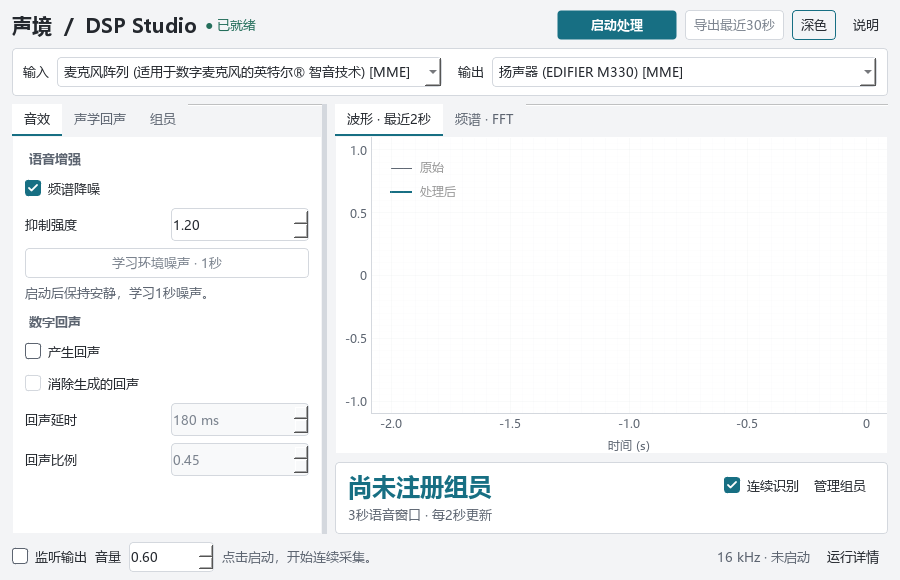
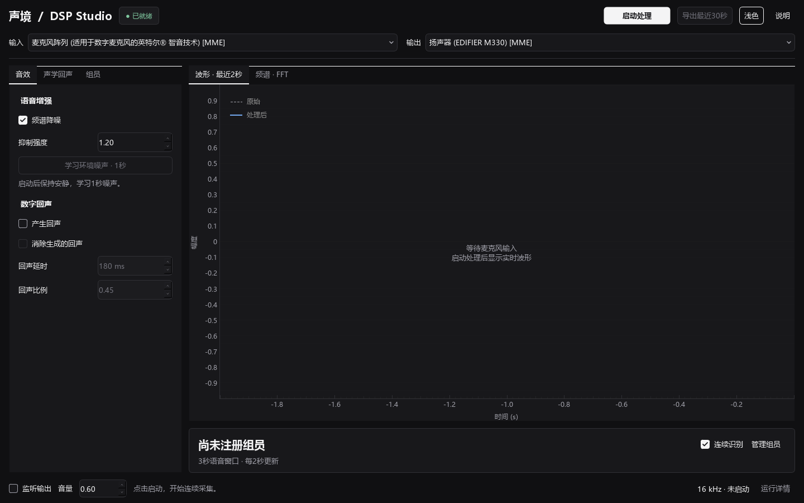
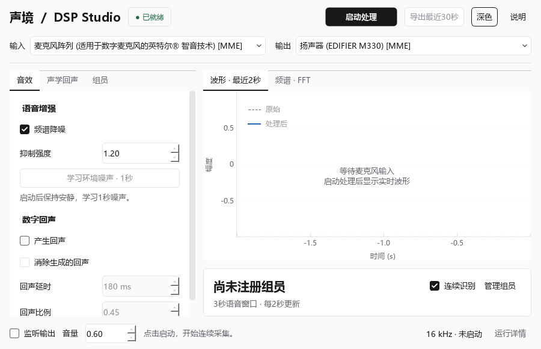
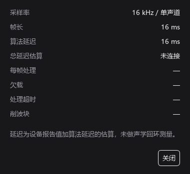

# OpenStatus-inspired 增量调整与验证

日期：2026-10-28。按用户指定的本地 `openstatus-inspired-ui` 技能及其 `references/design-spec.md` 执行。目标是精确、克制、数据优先的工程工具界面；不是复制OpenStatus产品。

## 改动

1. 默认深色、中性灰分层，保留浅色。主按钮、页签、选中与表单使用中性反差；绿色/琥珀/红色仅表示正常、准备与错误，并保留文字。
2. 保留原来的左侧控制页签、右侧信号观察与说话人结果。统一控件、边界、间距、复选框、下拉箭头和辅助窗口，没有增加导航业务或依赖。
3. 原始信号采用灰色虚线，处理后采用蓝色实线，保留图例、单位与时间范围，频谱范围固定0–8000 Hz。悬停读数来自当前曲线数据。
4. 空闲图表显示等待麦克风及下一步操作。运行详情用字段/数值两列排列，尚未取得的读数显示“—”。
5. 数值、单位采用现有Consolas，组员表的次数与相似度右对齐；中文正文使用Segoe UI与微软雅黑回退。

设计契约与问题清单：`ui/openstatus-contract.md`。参数来源：`ui/project-contract.json`，经原工作台生成器输出到新目录 `ui/generated-openstatus-v2/`。当前Qt适配读取新目录，旧生成物保留。

本轮主要变更为 `dsp_lab/theme.py`、`dsp_lab/ui.py`、界面契约与少量本地SVG控件图标。未修改DSP、音频传输、声纹实现、依赖清单；这些文件的前后SHA-256比对记录在 `validation/openstatus/baseline.json` 与最终摘要中。

## 设计来源

- 用户提供的本地技能：`C:/Users/xande/Downloads/openstatus-inspired-ui-codex/openstatus-inspired-ui/SKILL.md`。
- [OpenStatus官方模板主题](https://github.com/openstatusHQ/openstatus-template/blob/main/src/app/globals.css)：核对了深浅中性色、语义状态色和字体角色。
- [官方设计说明](https://www.openstatus.dev/blog/new-dashboard-we-are-so-back)：参考其布局聚焦和按需展示详情的思路。
- [官方示例](https://template.openstatus.dev/landing)。

仅采用视觉原则，沿用 DSP Studio 与现有音频业务，没有复制品牌标识、虚构监控指标或引入Web前端框架。

## 已执行验证

| 检查 | 结果与范围 |
|---|---|
| 项目回归 | 8项DSP相关测试通过 |
| 语法与依赖 | compileall与pip check通过，无新增依赖 |
| 主题生成 | 配置、14个生成文件一致性、20组文字对比度检查通过 |
| 界面矩阵 | 900×580、1024×768、1440×900；深/浅主题；1/1.5/2离屏Qt缩放 |
| 交互检查 | 每档缩放48项断言通过：动作条件、参数/页签保留、组员选中身份、数值对齐、图表空态与悬停读数、未知读数、详情Esc关闭、错误文字与颜色等 |
| 真实设备短测 | 25.062秒Qt绘图、独立音频进程、13次后台声纹任务并发；欠载0、处理超时0、削波0；本次观察到的处理耗时峰值约0.854 ms |
| 数据边界 | 真实设备短测输出静音，未保存麦克风音频；没有创建正式组员档案 |
| 原生桌面观察 | 检查了默认深色主窗口、空闲状态、设备选择与运行详情；检查时未通过界面开启麦克风 |

命令入口：`python -m pytest -q`、`python -m compileall -q app.py dsp_lab tools`、`python -m pip check`、`tools/verify_frontend.py --scale 1/1.5/2`（分别设置对应Qt缩放）、`tools/validate_gui.py`。生成一致性使用原技能的 `scripts/check.py --config ui/project-contract.json --generated ui/generated-openstatus-v2`。

本轮截图与详细结果位于 `validation/openstatus/`。受控组员、错误状态与人工波形只用于界面验证，文件名带 `controlled`，不属于实际组员识别或音质实验数据。

## 前后对照

## 内部设计复核

按技能的0–5分量表自查，属于内部判断，不是独立用户评价。

| 方面 | 自查 | 依据或保留项 |
|---|---:|---|
| 中性色与对比度 | 4 | 统一语义色，文字对比度脚本通过；未进行完整可访问性审计 |
| 字体与数值 | 4 | 中文回退、选择性等宽和右对齐；跨平台字体尚未覆盖 |
| 布局与密度 | 4 | 主要桌面尺寸检查通过；窄窗口控制区可局部滚动 |
| 控件一致性 | 4 | 主题覆盖输入、页签、表格和详情；系统原生文件选择器遵循Windows样式 |
| 表格与图表 | 4 | 真实数据、虚实线、单位、固定轴与读数；尚无屏幕阅读器专项测试 |
| 交互状态 | 4 | 空态、未连接、错误、运行和停止有检查 |
| 缩放与键盘 | 4 | 三档离屏缩放、共享快捷键和Esc；原生跨屏拖动尚未验证 |
| 功能保留 | 4 | 核心文件哈希不变、回归与短测通过；真实组员和房间验收仍待完成 |

## 未执行范围

原生混合DPI跨屏拖动、移动端、完整屏幕阅读器验证未执行。实际组员识别校准、房间回声效果、输出听感和10分钟稳定性仍按既有课程验收边界处理。25秒静音输出短测不能代替这些验收。
